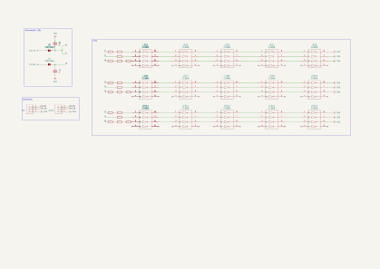
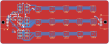
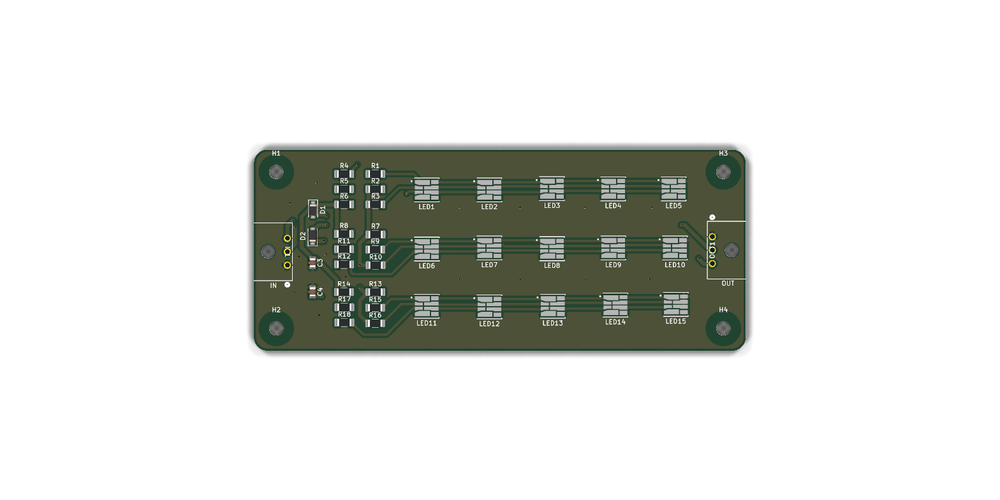

# IFS09-ASSI

Hardware design (KiCad schematic and PCB layout) for the **Autonomous System Status Indicator (ASSI)** board of the **IFS09**, developed for the **ISC Formula Student Racing Team** (Season 2026/2027).

[](https://www.comillas.edu/)
[]()
[]()
[-green.svg)]()
[]()

[](Schematics-1.0.pdf)

---

## Getting started

1. Create a GitHub account if you don't have one yet.
2. Download and install [GitHub Desktop](https://desktop.github.com/) (beginner) or [Git CLI](https://git-scm.com/book/en/v2/Getting-Started-Installing-Git) (advanced).

   - If this is your first time using GitHub Desktop, make sure to read the [User Manual](https://help.github.com/desktop/guides/).
   - If this is your first time using Git, start with a tutorial. There are many available online:
     - [Git Tutorial](https://git-scm.com/docs/gittutorial)
     - [Atlassian Git Tutorial](https://www.atlassian.com/git/tutorials/)
   - Keep a copy of [GitHub's Git Cheat Sheet](https://services.github.com/kit/downloads/github-git-cheat-sheet.pdf) handy as a reference.

3. Clone this repository to your machine:
   - SSH: `git@github.com:isc-fs/IFS09-ASSI.git`
   - HTTPS: `https://github.com/isc-fs/IFS09-ASSI.git`

4. To open the design, install [KiCad 10](https://www.kicad.org/download/) and set up the team library [IFS-KicadLib](https://github.com/isc-fs/IFS-KicadLib) (`ISC_KICAD_LIB` path variable), then open `hardware/ASSI/ASSI.kicad_pro`.

---

## How we work with this repository

### Main branches

The repository has two permanent branches:

**`main`** is the production branch. It contains only validated code that can be flashed onto the car. Never work directly on it.

**`dev`** is the development branch. It is the integration point where everyone's work comes together. Never work directly on it either — all changes arrive through a feature branch.

```
main  ──────────────────●──────────────────────●──▶  (validated releases only)
                        ↑                      ↑
dev   ──────●───●───●───●───●───●───●───●───●──●──▶  (continuous integration)
            ↑   ↑       ↑   ↑   ↑       ↑   ↑
          feat/1 fix/1 feat/2 fix/2   feat/3 fix/3
```

### Feature branches

All work — whether a new feature or a bug fix — is done on a **feature branch** created from `dev`. When the work is ready, a Pull Request is opened toward `dev`, reviewed, merged, and the branch is deleted.

There are two branch types, each with its own independent numeric counter:

```
feat/<n>   →  new functionality  (feat/1, feat/2, feat/3 ...)
fix/<n>    →  bug fix            (fix/1,  fix/2,  fix/3  ...)
```

The `feat` and `fix` counters are independent: `feat/2` and `fix/2` can exist at the same time with no conflict.

### Tracking branch history

Feature branches are deleted after merging to keep the repository clean. The history of each branch is preserved in **GitHub Issues**.

Every branch has one associated issue. The issue carries a **label** (`feat` or `fix`) and its title includes the branch number, for example: `[feat/3] Add CAN broadcast for mission state`. When the branch is merged and deleted, the issue is closed — becoming a permanent record of all the work done.

To see which branches are currently active: filter issues by label and status `open`.
To browse the full history: filter by label and status `closed`.
The number for the next branch of each type is the last closed issue of that type plus one.

> Example: if the last closed issue with label `feat` is `[feat/4] ...`, the next feature branch will be `feat/5`.

---

## Automation

The repository includes a GitHub Actions workflow that manages tracking issues automatically. No setup is required — it works for every developer as soon as they create a branch.

### Automatic issue creation

When a `feat/*` or `fix/*` branch is pushed to GitHub, the workflow automatically opens an issue with:

- The corresponding `[feat/N]` or `[fix/N]` title
- The correct label (`feat` or `fix`)
- A template with sections for describing the work and adding notes
- The name of the developer who created the branch

### Wrong number warning

If the branch number is not the next expected one (either too low or too high), the issue will display a warning indicating the correct number and asking the developer to delete and recreate the branch with the right name.

### Auto-fill description from first commit

When the developer makes their first commit and pushes it, the workflow automatically updates the *"What does this branch do?"* section of the issue with that commit message.

- If the developer manually edits the issue before pushing their first commit, the workflow will not overwrite the description.
- The description is only updated once — subsequent commits do not modify the issue.

---

## Step-by-step workflow

### 1. Create the branch

```bash
# Make sure you are on an up-to-date dev
git checkout dev
git pull origin dev

# Create your branch using the next available number for its type
# (last closed issue of that type + 1)
git checkout -b feat/5    # or fix/3, depending on that type's counter
```

> To find the right number: go to **Issues → filter by label `feat` or `fix` → sort by newest** and read the last number.

### 2. Push the branch

```bash
git push origin feat/5
```

The tracking issue will be opened automatically on GitHub within seconds.

### 3. Work and commit

```bash
# Make your changes and commit with a clear, descriptive message
git add .
git commit -m "short description of what this commit does"

# Push the changes
git push origin feat/5
```

The message of your **first commit** will be used to automatically fill in the issue description.

### 4. Open a Pull Request

When the work is ready, open a Pull Request on GitHub from your branch toward `dev`. In the PR description write `Closes #<issue-number>` so the issue closes automatically when the PR is merged.

Before requesting a review, check that:
- KiCad ERC and DRC report no errors
- The schematic PDF and the images in `docs/images/` match the design
- You have tested the change on the bench if applicable
- The PR targets `dev`, not `main`

### 5. Review and merge

Another team member will review the PR. Once approved, it is merged into `dev` and the branch is deleted. The issue will be closed as a permanent record.

### 6. Merging into main

When `dev` holds a set of validated changes that are ready for the car, a responsible team member opens a Pull Request from `dev` into `main`. This only happens after full firmware validation (HIL/bench).

---

## 1. Project overview

The ASSI shows the state of the Autonomous System to people around the car, as required by the Formula Student rules:

| AS state | ASSI |
| :--- | :--- |
| AS Off | Off |
| AS Ready | Yellow, continuous |
| AS Driving | Yellow, flashing |
| AS Emergency | Blue, flashing |
| AS Finished | Blue, continuous |

This board is a **passive LED board**: it has no microcontroller or logic. It lights yellow or blue depending on which of its two 24 V inputs is powered, so the colour and the flashing are decided by whatever drives those two lines.

```
            +--------------------- ASSI board ---------------------+
 IN1        |                                                      |        OUT1
 24V_YW ----+--> D2 --+--> R + G channels --> 3 rows x 5 LEDs --+  +---- 24V_YW
 24V_BL ----+--> D1 --+--> B channel -------> 3 rows x 5 LEDs --+  +---- 24V_BL
 GND -------+---------------------------------------------------+--+---- GND
            +------------------------------------------------------+
```

`IN1` and `OUT1` are wired pin to pin, so several ASSI boards can be daisy-chained from one harness branch.

### Mounting configuration

* Each ASSI is made of **two boards (A and B)** mounted next to each other, touching along the long edge, with the same orientation so the LED columns line up.
* The harness connects to `IN1` of board A, and board B connects to `OUT1` of board A (daisy chain). `OUT1` of board B is left unconnected.
* Board A carries the current of both boards: up to ~370 mA on `24V_BL` in blue mode.
* The car has three ASSIs (two sides and rear), so **6 boards** per car. A single board at the rear is being considered (5 boards per car).

---

## 2. Rules compliance (FS Rules 2026 v1.1)

| Rule | Requirement | This design |
| :--- | :--- | :--- |
| T 14.9.1 | Yellow/blue states as in the table above. "AS Driving" and "AS Emergency" flash at 2–5 Hz with 50 % duty cycle. | The board only lights the colour. The flashing frequency and duty cycle must be generated by the controller that drives `24V_YW` / `24V_BL`. |
| T 14.9.2 | Three ASSIs: one on each side behind the driver's compartment and one at the rear on the centreline. | Three ASSIs of two boards each (6 boards per car). |
| T 11.9.5 | Safe state of the ASSI signal is "AS Off". | With no supply the board is off. |
| T 11.10.1 | Black background. | The PCB solder mask is green: the enclosure must give a black background around the LEDs, or the board must be ordered with black solder mask. |
| T 11.10.1 | Minimum illuminated surface of 15 cm² with even luminous intensity. | Two boards: ≈ 40 cm² between LED centres (55.7 mm × ~72 mm). If the rear ASSI uses a single board, it has only ≈ 14.8 cm² between LED centres (≈ 20 cm² including the LED bodies), which is borderline, so that ASSI needs a diffuser or window of at least 15 cm² (see #16). |
| T 11.10.1 | LEDs without diffuser no more than 20 mm apart. | Within a board the LED pitch is 14 mm horizontally and 13 mm vertically. Between boards A and B the vertical distance is 18.7–19.2 mm, so it only stays below 20 mm if the boards touch and the LED columns are aligned. |
| T 11.10.1 | Clearly visible in very bright sunlight. | To be checked on the first boards (see #9). |

---

## 3. Schematic

<p align="center">
  <a href="Schematics-1.0.pdf">
    
  </a>
  <br>
  <sub><em>Click on the preview to open the vector PDF (<a href="Schematics-1.0.pdf">Schematics-1.0.pdf</a>)</em></sub>
</p>

### 3.1 Supply inputs

* **`24V_YW`** feeds the red and green LED channels together through diode `D2` (red + green = yellow).
* **`24V_BL`** feeds the blue LED channel through diode `D1`.
* `D1` and `D2` are Nexperia PMEG4010CEH Schottky diodes (1 A, 40 V, SOD-123F). They block reverse polarity on each input.
* `C4` (yellow rail) and `C3` (blue rail) are 100 nF 0805 capacitors to GND after each diode.

### 3.2 LED strings

* 15 × Cree **CLQ6B** RGBW LEDs (`LED1`–`LED15`), arranged as **3 rows of 5 LEDs in series**.
* Each row has its own 1206 series resistors per colour channel (`R1`–`R18`):
  * Red: 2 × 300 Ω in series (`R1`+`R2`, `R7`+`R9`, `R13`+`R15`)
  * Green: 1 × 1 kΩ (`R3`, `R10`, `R16`)
  * Blue: 3 × 47 Ω in series (`R4`+`R5`+`R6`, `R8`+`R11`+`R12`, `R14`+`R17`+`R18`)
* The white die of the CLQ6B is not used (see #17).

### 3.3 Currents and resistor power

String current: `I = (24 V − V_D − 5 × V_F) / R_string`, with V_D ≈ 0.4 V for the Schottky diode.

| Channel | V_F per LED (est.) | R_string | Current per string | Power per resistor (I²·R) |
| :--- | :---: | :---: | :---: | :---: |
| Red | 1.84 V | 600 Ω (2 × 300 Ω) | ~24 mA | ~173 mW |
| Green | 2.4 V | 1 kΩ | ~11.6 mA | ~135 mW |
| Blue | 3.0 V | 141 Ω (3 × 47 Ω) | ~61 mA | ~175 mW |

* Input current: ~183 mA on `24V_BL` (D1) and ~107 mA on `24V_YW` (D2), well below the 1 A rating of the PMEG4010CEH.
* Board dissipation: ~4.4 W in blue mode and ~2.6 W in yellow mode.
* V_F values are estimates. The currents must be confirmed on the first boards (see #6).

**Resistor rating check.** The resistors are Panasonic ERJ-P08 anti-surge thick film, 1206, **0.66 W**, ±1 %. Per the Panasonic datasheet, the rating is 100 % up to 70 °C ambient and derates linearly to 0 at 155 °C. Design rule: power ≤ 60 % of the derated rating.

| Board temperature | Derated rating | 60 % limit | Worst resistor (blue, 175 mW) |
| :---: | :---: | :---: | :---: |
| ≤ 70 °C | 0.66 W | 396 mW | 27 % of rating |
| 85 °C | 0.54 W | 326 mW | 32 % of rating |
| 100 °C | 0.43 W | 256 mW | 41 % of rating |

The 60 % rule is met for every resistor up to a board temperature of about 117 °C.

### 3.4 Connectors

`IN1` and `OUT1` are Molex Micro-Fit 3.0, 3 circuits, right-angle (43650-0300), with the same pinout:

| Pin | Net | Description |
| :---: | :--- | :--- |
| 1 | `GND` | Ground |
| 2 | `24V_YW` | 24 V supply for yellow |
| 3 | `24V_BL` | 24 V supply for blue |

The connectors overhang the board edge on purpose (see #13).

---

## 4. PCB layout

<p align="center">
  
</p>
<p align="center">
  
</p>

| Parameter | Value |
| :--- | :--- |
| Board size | 110 mm × 45 mm |
| Layers | 2, GND pour on both layers |
| Thickness | 1.6 mm |
| Track widths | 0.8 mm `Power` net class (`24V_YW`, `24V_BL`, `/G`, `/B`, `GND`), 0.5 mm `LED` net class (LED strings), 0.2 mm elsewhere |
| Vias | 27 × 0.6/0.3 mm, 15 of them GND stitching vias between both layers |
| Mounting holes | 4 × M3 (3.2 mm, non-plated, not connected to GND), with an 8 mm copper keep-out on both layers so the screw head and washer do not sit on copper |
| Other non-plated holes | 2 × 3.05 mm: locating pegs of the Micro-Fit connectors |
| Components | 37 SMD + 2 through-hole connectors, all on the top side |

---

## 5. Bill of materials

| Reference | Qty | Part | Manufacturer | MPN | Footprint |
| :--- | :---: | :--- | :--- | :--- | :--- |
| `LED1`–`LED15` | 15 | RGBW LED | CreeLED | CLQ6B-TKW-S1L1R1H1TBB7935BB3 | `ISC_modulos_pcb:SMT_B7935BB3_WFS` |
| `R1`, `R2`, `R7`, `R9`, `R13`, `R15` | 6 | Resistor, 300 Ω, 1 %, 0.66 W | Panasonic | ERJ-P08F3000V | `Resistor_SMD:R_1206_3216Metric_Pad1.30x1.75mm_HandSolder` |
| `R3`, `R10`, `R16` | 3 | Resistor, 1 kΩ, 1 %, 0.66 W | Panasonic | ERJ-P08F1001V | `Resistor_SMD:R_1206_3216Metric_Pad1.30x1.75mm_HandSolder` |
| `R4`–`R6`, `R8`, `R11`, `R12`, `R14`, `R17`, `R18` | 9 | Resistor, 47 Ω, 1 %, 0.66 W | Panasonic | ERJ-P08F47R0V | `Resistor_SMD:R_1206_3216Metric_Pad1.30x1.75mm_HandSolder` |
| `C3`, `C4` | 2 | Capacitor, 100 nF, 50 V, X7R | Samsung Electro-Mechanics | CL21B104KBCNNNC | `Capacitor_SMD:C_0805_2012Metric` |
| `D1`, `D2` | 2 | Schottky diode, 1 A, 40 V | Nexperia | PMEG4010CEH | `Diode_SMD:D_SOD-123F` |
| `IN1`, `OUT1` | 2 | Micro-Fit 3.0 header, 3P, right-angle | Molex | 43650-0300 | `ISC_conectores:CONN_SD-43650-001_03_MOL` |

The same list is exported as [`bom.csv`](hardware/ASSI/production/bom.csv), and the component positions as [`positions.csv`](hardware/ASSI/production/positions.csv).

---

## 6. Open points

| Issue | Status |
| :--- | :--- |
| #6 Thermal | Copper improvements done. The 30-minute bench test in blue mode is pending until boards are built. |
| #9 Yellow colour | To be checked in daylight on the first boards. |
| #10 TVS on the inputs | Low priority, not decided yet. |
| #14 3D models | To be added in IFS-KicadLib. |
| #15 Fiducials | Depends on how the board will be assembled. |
| #16 LED coverage of the board | With two boards per ASSI the illuminated surface is ≈ 40 cm². Still to be decided with the enclosure design, especially if the rear ASSI uses a single board (see T 11.10.1 above). |

---

## 7. Repository structure

```
hardware/ASSI/             KiCad project (schematic and PCB layout)
hardware/ASSI/production/  Fabrication output:
                             ASSI.zip       Gerber + drill package
                             netlist.ipc    IPC-D-356 netlist
                             bom.csv        Bill of materials with manufacturer and MPN
                             positions.csv  Component placement (pick and place)
Schematics-1.0.pdf         Schematic exported to PDF
docs/images/               Images used in this README
```

The CLQ6B symbol and footprint, the connector footprint and the ISC logo come from [IFS-KicadLib](https://github.com/isc-fs/IFS-KicadLib). The resistor, capacitor and diode footprints come from the standard KiCad libraries.

---

*ISC Racing Team — IFS09 Driverless*
